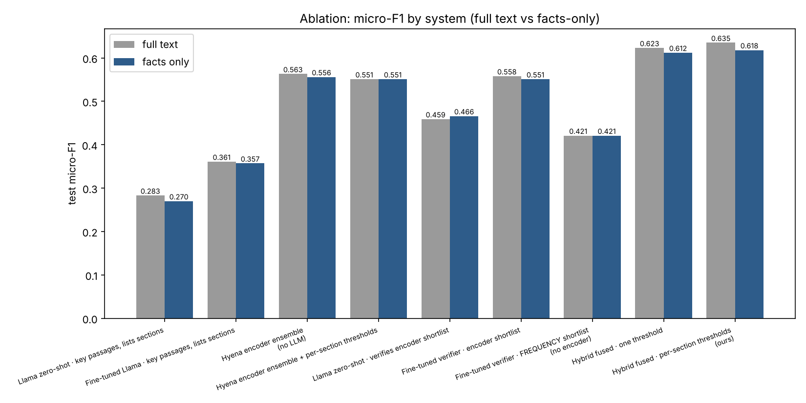
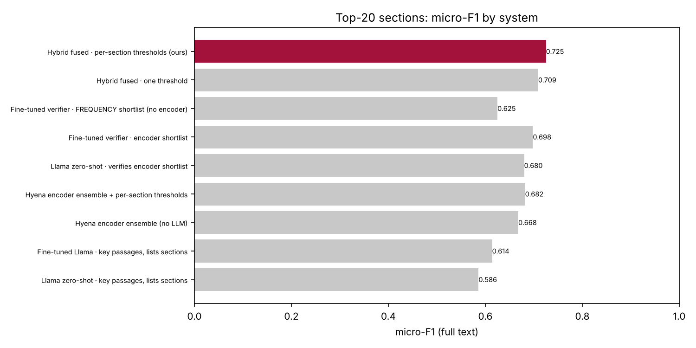
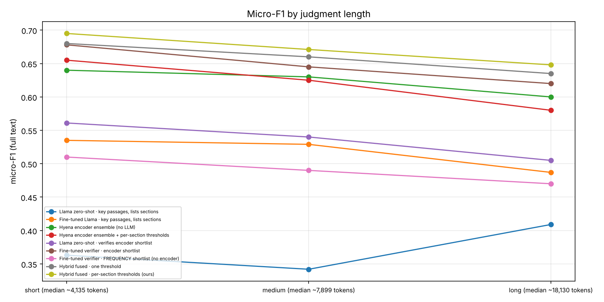
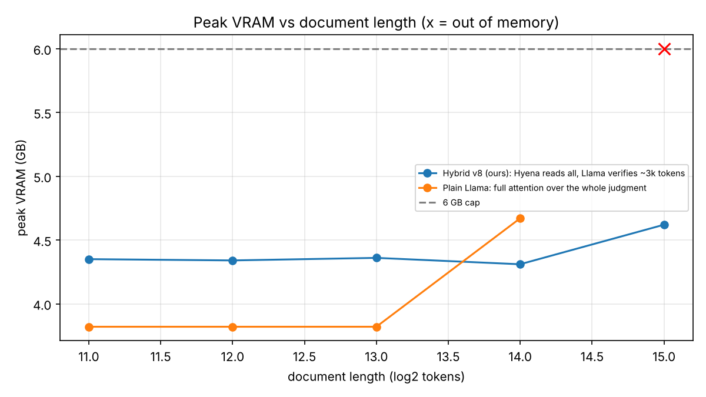
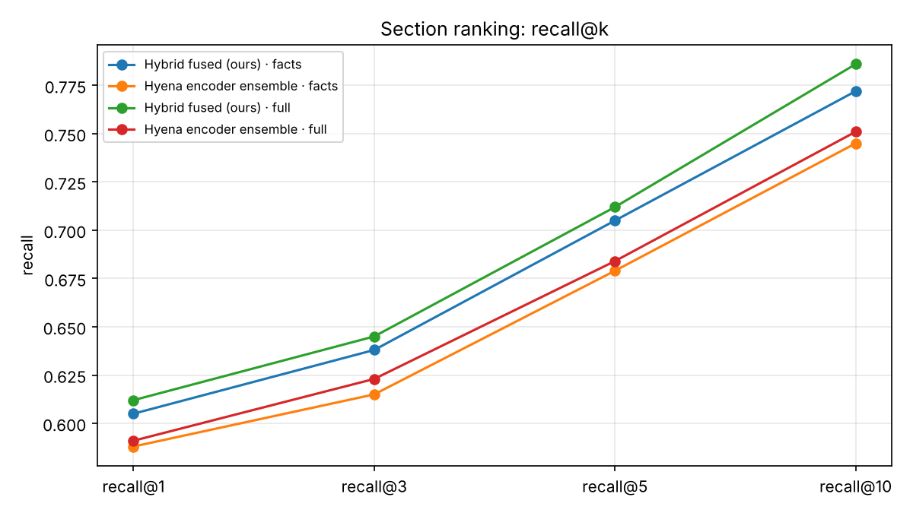

# Hyena + Llama Hybrid for IPC Section Prediction on Indian Judgments

Deep Learning end-semester project. Given a full Indian Supreme Court judgment, which can run past 30k tokens, the system predicts the
**Indian Penal Code (IPC) sections** involved and backs each one with evidence sentences from the judgment. On top of the model sits an offline
**IPC Section Assistant** (web app + terminal UI). It explains the judgment and answers questions about it. A Bayesian router decides
whether to answer from the judgment, search an offline legal library, or ask for clarification.

```
judgment ─► sentences ─► InLegalBERT (frozen, overlapping windows) ─► one vector per sentence
   ─► Hyena encoder ensemble over ALL sentences (FFT long convolution, label-wise attention) ─► P_enc for 100 sections + evidence
   ─► shortlist of high-recall candidates
   ─► Llama-3.2-3B QLoRA verifier reads opening + key passages + evidence, answers "Section 302: yes/no" ─► P_llm
   ─► fusion α·P_enc + (1−α)·P_llm, per-section thresholds tuned on dev ─► final IPC sections
```

The Hyena encoder reads the *whole* document in sub-quadratic time, so the LLM only verifies a ~3k-token prompt. Peak VRAM stays flat
(~4.3 GB) at any document length, while plain Llama runs out of memory at 32k tokens.

---

## Repository structure

| Path | Contents |
|---|---|
| `model_files/` | **The trained model**, which the app loads directly from here |
| `model_files/hybrid_model.pt` | Hyena encoder ensemble + fusion weights, thresholds, label names (Git LFS) |
| `model_files/llama_lora/` | Llama-3.2-3B QLoRA verifier adapter + tokenizer (Git LFS) |
| `model_files/hyena_llama_legal_v8.ipynb` | Kaggle training notebook: data preparation, training and evaluation |
| `app/` | **Application source code**: the offline assistant built on the trained model |
| `app/ipc/` | Core package: `pipeline.py` (model inference), `engine.py`, `retriever.py` + `bayes.py` (Bayesian router), `reranker.py`, `grounding.py`, `llm.py`, `statutes.py`, … |
| `app/app.py`, `tui.py`, `analyse.py` | Web app (FastAPI, port 7860), terminal UI, one-shot CLI |
| `app/web/` | Web front-end and architecture explainer page |
| `app/kaggle/` | Notebooks that generate questions, label them, and run the evaluation for the router |
| `app/tests/` | Test scripts (run with `python -m tests.<name>`) |
| `app/legal_kb/` | Offline legal knowledge base (statute cards + judgment passages, InLegalBERT embeddings) |
| `app/legacy/` | Earlier versions of the app, kept for reference |
| `results/` | Evaluation tables (CSV) and plots (PNG) |

More detailed documentation: [`app/README.md`](app/README.md) (full user guide),
[`TESTING.md`](app/TESTING.md), [`FEATURES.md`](app/FEATURES.md), [`KAGGLE.md`](app/KAGGLE.md).

---

## Dataset

| | |
|---|---|
| **Source** | [Indian Supreme Court Judgments](https://registry.opendata.aws/indian-supreme-court-judgments/), public AWS Open Data bucket `s3://indian-supreme-court-judgments` (judgments from 2005–2024, PDF + metadata) |
| **Labels** | IPC sections cited in each judgment, extracted by regex. Task: multi-label classification over the **100 most frequent IPC sections** (each with ≥ 15 occurrences) |
| **Leakage control** | Section numbers are **masked** in the text ("Section 302" → hidden), so the model has to infer sections from the facts. A second **facts-only** view also removes every sentence that cites a section |
| **Split (temporal)** | train: judgments ≤ 2020 · dev: 2021–2022 · test: ≥ 2023 (no case appears in two splits) |
| **Evaluation set** | 150 test judgments, in three length bands of 50: short (~4k tokens), medium (~8k), long (~18k) |
| **Pretrained models** | [`law-ai/InLegalBERT`](https://huggingface.co/law-ai/InLegalBERT) (frozen sentence encoder), [`unsloth/Llama-3.2-3B-Instruct`](https://huggingface.co/unsloth/Llama-3.2-3B-Instruct) (verifier base: ungated mirror of Meta's Llama-3.2-3B-Instruct, QLoRA 4-bit) |
| **Router data** | ~3,000 auto-graded questions over ~300 judgments (`make_questions.py` → `label_ipc.py`). Labelled outputs: `app/ipc_qwen2.5-7b_shard*.jsonl` |
| **Included samples** | `app/test-case-files/*.pdf` (4 judgments), `sample_judgment.pdf`, `stress_cases.json`, `eval_questions.json` |

The training notebook downloads and prepares the full corpus itself (section 5, `prepare_data.py`). The raw corpus is not stored in
this repository because of its size.

---

## Setup

**Requirements:** Python 3.12, NVIDIA GPU with ≥ 6 GB VRAM (it also runs on CPU, slowly), ~15 GB of free disk, and optionally
[Ollama](https://ollama.com) for the chat model.

```bash
git lfs install
git clone https://github.com/gogul098/Deep_learning_end_sem_project.git
cd Deep_learning_end_sem_project/app
git lfs pull                           # make sure model_files/ holds the real weights, not LFS pointers

python -m venv .venv
source .venv/bin/activate              # Windows: .venv\Scripts\activate
pip install torch --index-url https://download.pytorch.org/whl/cu126
pip install -r requirements.txt
```

**Models.** No Hugging Face token is needed. The trained model is already in `model_files/`, and the base models are public:

```bash
python download_model.py               # links ../model_files + downloads Llama-3.2-3B base & InLegalBERT → ./models
python download_reranker.py            # cross-encoder reranker (~90 MB)
ollama pull qwen2.5:7b                 # optional chat model
```

**How the app finds the model:** `download_model.py` writes `app/models/paths.json`:

```json
{"final": "../../model_files", "base_model": "llama", "legal_encoder": "inlegalbert"}
```

`ipc/pipeline.py` reads this file and loads `hybrid_model.pt` and `llama_lora/` from `model_files/`.
There is only one copy of the weights. To use a model from a Hugging Face repo instead, run
`python download_model.py --repo <hf-user>/<model-repo>`. For a private repo, set `HF_TOKEN` in your shell only, never in a file.

On Arch Linux, `./setup_arch.sh` does all of the above (it runs `./download.sh` itself).

## Execution

Run these from `app/`:

```bash
python app.py                          # web app → http://127.0.0.1:7860   (architecture page: /architecture)
python tui.py                          # terminal UI
python analyse.py judgment.pdf         # one-shot analysis of a judgment
python analyse.py test-case-files/ --json out.json   # every PDF in a folder → JSON
python -m tests.test_bayes             # Bayesian network check (CPU, no models needed)
python -m tests.test_retriever sample_judgment.pdf   # retriever check (CPU)
python -m tests.test_pipeline sample_judgment.pdf    # model pipeline (needs downloaded models)
python -m tests.test_engine sample_judgment.pdf      # end-to-end
```

Useful options: `--model <ollama-tag>` (chat model), `--verifier none` (Hyena encoder only, ~0.4 GB VRAM).

**Reproducing training:** open `model_files/hyena_llama_legal_v8.ipynb` on Kaggle (GPU T4 ×2, Internet on), add `HF_TOKEN` under
*Add-ons → Secrets* (only needed to push checkpoints to the Hub), and run all cells. The notebook writes `ablation_results.csv`, the
model files and the other results listed below.

---

## Results

Test set: 150 judgments, citation numbers hidden. Micro-averaged scores unless marked otherwise.

### Ablation: 100 IPC sections, full text ([`results/ablation_results.csv`](results/ablation_results.csv))

| System | Precision | Recall | Micro-F1 | Macro-F1 |
|---|---|---|---|---|
| Llama-3.2-3B zero-shot (lists sections) | 0.309 | 0.262 | 0.283 | 0.159 |
| Fine-tuned Llama (lists sections) | 0.512 | 0.279 | 0.361 | 0.135 |
| Hyena encoder ensemble (no LLM) | 0.584 | 0.543 | 0.563 | 0.306 |
| Fine-tuned verifier on encoder shortlist | 0.687 | 0.470 | 0.558 | 0.286 |
| Fine-tuned verifier on frequency shortlist (no encoder) | 0.658 | 0.309 | 0.421 | 0.069 |
| **Hybrid fused, per-section thresholds (ours)** | **0.652** | **0.621** | **0.635** | **0.446** |

Facts-only view (all citing sentences removed): hybrid micro-F1 **0.618** against 0.556 for the encoder alone.

### Other results
* **Top-20 most frequent sections** ([`top20_sections_results.csv`](results/top20_sections_results.csv)): hybrid micro-F1 **0.725**, macro-F1 0.710.
* **Ranking** ([`ranking_results.csv`](results/ranking_results.csv)): hybrid recall@10 **0.786**, precision@1 0.753.
* **Robust to document length** ([`results_by_length.csv`](results/results_by_length.csv)): hybrid F1 0.695 (short) → 0.671 (medium) → 0.648 (long).
* **Memory** ([`vram_vs_length.csv`](results/vram_vs_length.csv)): the hybrid stays at 4.3–4.6 GB peak VRAM from 2k to 32k tokens.
  Plain Llama full attention runs **out of memory at 32k** tokens on the same GPU.

| | |
|---|---|
|  |  |
|  |  |
|  | |

---

## Notes
* The included checkpoint and the numbers in `results/` come from an earlier run of this training pipeline; the notebook is its latest version.
* No secrets are stored in this repository. Tokens are read from the `HF_TOKEN` environment variable or from Kaggle Secrets at runtime.
  `.gitignore` excludes `.env` files, virtual environments and downloaded models.
* Large binaries (`*.pt`, `*.safetensors`, `*.npy`) are stored with **Git LFS**.
* Licences: Llama 3.2 Community Licence (verifier base), MIT (InLegalBERT). The judgments are public court records.
